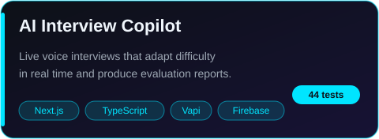
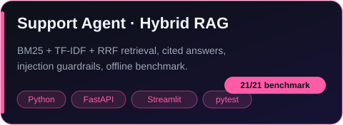

<div align="center">



<br/>

**I build AI products that are tested, evaluated and safe to ship — not just demos.**


</div>

<br/>

<div align="center">

</div>

## ✨ Featured work

<table>
<tr>
<td width="50%"><a href="https://github.com/anonymousproxi/ai-interview-copilot"></a></td>
<td width="50%"><a href="https://github.com/anonymousproxi/rag-intelligent-document-retrieval"></a></td>
</tr>
<tr>
<td width="50%"><a href="https://github.com/anonymousproxi/Betafold"></a></td>
<td width="50%"><a href="https://github.com/anonymousproxi/EL-Pais-Webscraping-Automation"></a></td>
</tr>
</table>

## 🧠 How I like to build

```text
 idea ──▶ prototype ──▶ tests ──▶ evaluation ──▶ guardrails ──▶ ship
                          ▲                          │
                          └──── measure, then fix ◀──┘
```

- **Test first, claim second** — every headline number in my repos comes from a runnable test or benchmark.
- **Boundaries over prompts** — sensitive data never reaches the model; tools return redacted views.
- **Deterministic by default** — reproducible offline modes so results can be verified, not trusted.

<div align="center">

<br/>

*"Always experimenting, always improving."*


</div>
