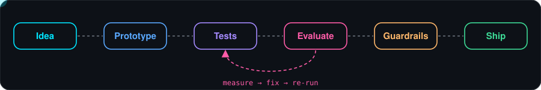

 

### I build AI products that are **tested, evaluated and safe to ship** — not just demos.

  

 

## ✨ Featured work

<table>
<tr>
<td width="50%"></td>
<td width="50%"></td>
</tr>
<tr>
<td width="50%"></td>
<td width="50%"></td>
</tr>
</table>

## 🧪 How I build

<table>
<tr>
<td width="33%" valign="top">

**✅ Test first, claim second** 
Every headline number in my repos comes from a runnable test suite or benchmark.

</td>
<td width="33%" valign="top">

**🛡️ Boundaries over prompts** 
Sensitive data never reaches the model; tools return redacted views.

</td>
<td width="33%" valign="top">

**🔁 Deterministic by default** 
Reproducible offline modes so results can be verified, not trusted.

</td>
</tr>
</table>

## 🧰 Toolbox

| | |
|---|---|
| **Languages** |    |
| **AI & Data** |        |
| **Web & APIs** |      |
| **Cloud & Data stores** |    |
| **Testing & QA** |     |

 

*"Always experimenting, always improving."*

